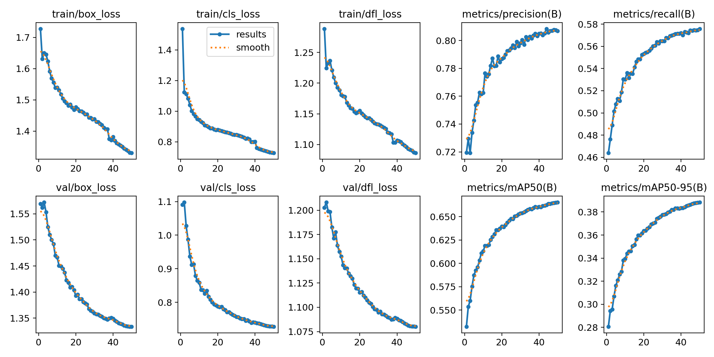

# Human Limb Localization with YOLO

A course experiment from my master's programme at Harbin Institute of Technology, Shenzhen (May 2025). I fine-tuned Ultralytics YOLO detectors to find people in images, label each person as seen from the front or the back, and localize their hands and feet.

Detected classes: `front`, `back`, `left_hand`, `right_hand`, `left_foot`, `right_foot`.

## What is in this repository

| File | What it does |
|---|---|
| `train_yolov8.py` | Fine-tunes YOLOv8n for 50 epochs at 640 px with AdamW, batch 16, on GPU 0 |
| `train_yolo.py` | The same YOLOv8n fine-tuning with Ultralytics defaults, saving to a named run folder |
| `split_data.py` | Shuffles a folder of images and YOLO label files and splits it 80/20 into train and val |
| `train_val_split.py` | The same split from the command line (`--datapath`, `--train_pct`) |
| `yolo_detect.py` | Runs a trained model on an image, a folder, a video, a USB camera or a Raspberry Pi camera, draws the boxes and can record the output |
| `runs/` | Training logs, metric curves and confusion matrices from the runs below |
| `yolo11n.pt` | Pretrained YOLO11n checkpoint from Ultralytics |
| `requirements_yolov8_8.2.0.txt` | Pinned environment (Ultralytics 8.2.0) |
| `Experiment 1 - Human Limb Localization Using YOLO.pdf` | The course report |

`__init__.py` is a copy of the configuration module from Ultralytics and is covered by their AGPL-3.0 licence.

## Results

Two training runs are logged in `runs/`. The numbers come from the last epoch of each `results.csv`.

| Run | Data | Epochs | Precision | Recall | mAP50 | mAP50-95 |
|---|---|---:|---:|---:|---:|---:|
| Large set, front/back labels | over 600,000 person boxes labelled `front` or `back` | 50 | 0.807 | 0.576 | **0.665** | **0.388** |
| Small set, all six classes | about 1,500 hand-labelled boxes (`data_small`) | 100 | 0.288 | 0.177 | 0.148 | 0.061 |

What the runs show:

- On the large set the detector learned the front/back distinction well: in the validation confusion matrix only 29 of about 113,000 matched boxes swap `front` and `back`. Most of the remaining error is people the model missed or extra boxes on background.
- The large set has no hand or foot labels, so that run says nothing about limbs.
- On the small hand-labelled set, which does include limbs, accuracy stayed low (mAP50 0.148). With about 70 to 175 boxes per limb class, there was not enough labelled data for the detector to learn small, often occluded hands and feet.

The second run's `args.yaml` records `yolov8x.pt`, 736 px images, batch 2 and the Adam optimizer, although its folder is named `train_session_yolov8n`.



## Running it

```bash
pip install -r requirements_yolov8_8.2.0.txt

# split your own images/ and labels/ folders 80/20
python train_val_split.py --datapath path/to/data --train_pct 0.8

# detect on a folder of images with a trained model
python yolo_detect.py --model path/to/best.pt --source path/to/images --thresh 0.5

# or on a webcam, recording the result
python yolo_detect.py --model path/to/best.pt --source usb0 --resolution 1280x720 --record
```

The training scripts point to Windows paths on my machine (`D:\AI Project\...`). Change the `data=` path to your own dataset YAML before training.

## Notes

- The dataset images are not included. The report describes the person data as coming from the CrowdHuman dataset.
- Trained weights (`best.pt`, `last.pt`) are stored with Git LFS. Run `git lfs pull` after cloning to download them.

## Stack

Python, PyTorch, Ultralytics YOLOv8 / YOLO11, OpenCV.
